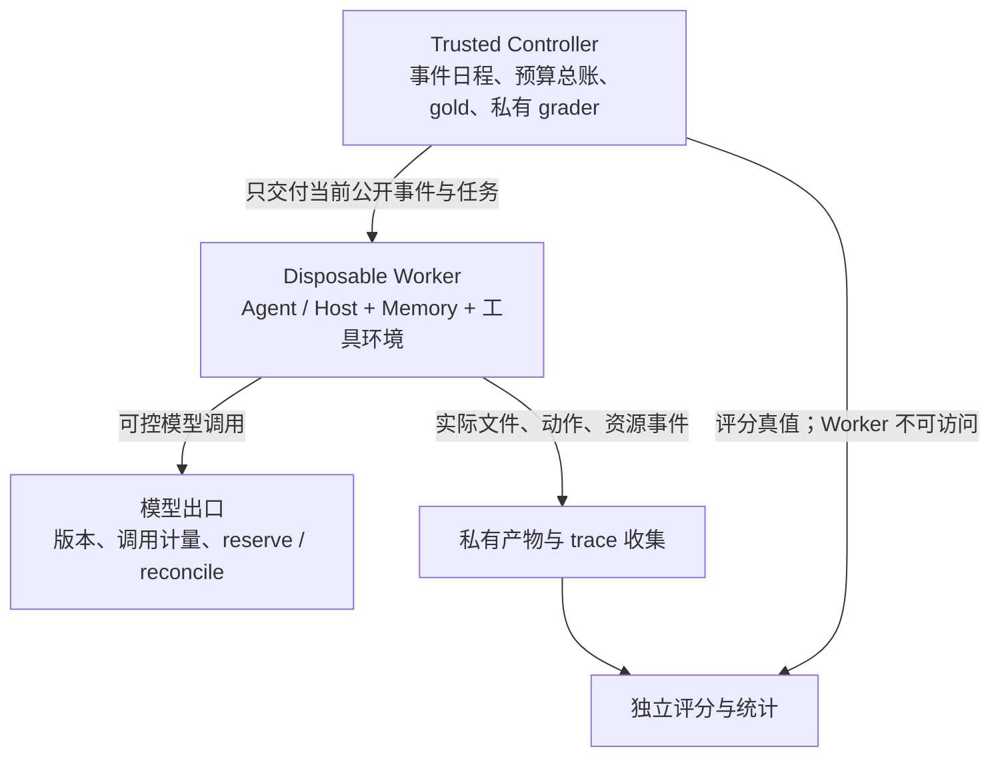

# Benchmark 测试环境：先建 Sandbox，再按规模引入 EKS

日期：2026-10-14，Asia/Shanghai。状态：**H0 实施设计，环境未部署，Benchmark 未运行。**

建议第一版采用“可信 Controller + 可替换 Worker”架构。Controlled Harness 先在独立 Linux VM 内运行，容器负责依赖打包和资源限制；macOS 原生 App 用独立 Mac 测试环境。EKS 是后续 Linux 批量调度后端，不是第一版前置依赖。

## 1. 三类环境各自负责什么

| 环境 | 用途 | 不应据此声称 |
| --- | --- | --- |
| 本机临时目录与模拟接口 | P0 schema、事件重放、预算账、评分器正负控 | 完成模型/Agent 效果或隔离验收 |
| 独立 Linux VM + 容器 Worker | Controlled Harness、CLI/daemon 集成、故障注入 | 测过 macOS App 的 Native Memory |
| 独立 macOS 测试用户/profile；必要时专用 Mac 或经资格检查的 macOS VM | 本地 ChatGPT App/Codex 等真实 App 的 session、Native Memory、压缩和接手 | Linux CLI 与桌面 App 等价、单独换目录就隔离了账号记忆 |
| 可选 EKS Worker | 已跑通的 Linux 作业并行、回收、日志/产物收集 | Kubernetes namespace 自动保证 gold 隔离或降低测量偏差 |

真实 App 的测试账号、服务端 Memory、同步与后台任务也属于初态，不能只清本地文件。若无法隔离这些状态或固定版本，保留黑盒产品观察范围，不能进入依赖这些条件的正式机制比较。macOS VM 的可运行性、授权和 App 行为必须先核验，不能预设可用。

## 2. 控制面与被测环境分离

Controller 在被测 Worker 之外保管 gold、未来事件、其他组 trace 和预算凭据。Worker 不挂载完整 Benchmark 仓库：本仓库公开 examples 同目录包含 gold，只能用于开发；正式验证必须另建未公开的封存材料。

Worker 仅能读取当前公开 prefix、自己的合法状态和业务工具。评分不把答案、错误解释或 Judge 调试内容返回后续历史。需要模型出口的 Controlled Harness 统一计量；真实 App 的隐藏调用未必能接入该出口，不可观测用 unknown，并单列可执行的停止/费用控制。

## 3. 长期历史的状态单位

一次状态空间绑定 `cluster_id / history_id / counterfactual_branch / system_id / lifecycle_profile / replicate`，运行整段历史。**不能每条消息重建空 Sandbox**，否则测不到长期 Memory。

每个 checkpoint 在该系统自己的隔离副本上执行 probe；不能把 RecallLedger 的成熟状态复制给 Native，也不能在不同反事实分支间复用热会话。probe 的答案、生成文件和诊断反馈不进入后续主历史。无法 clone 的 Host 按固定 prefix 从干净初态重放，费用和状态等价性单列。

状态至少包括工作文件、Memory DB/索引、Host session/profile、候选队列、后台任务和缓存。热会话、新会话、进程重启、Pod 重建、VM 重建分别命名，并定义哪些状态应保留、哪些应重置。测试结束后收集产物、结算或取消后台作业，再回收该状态空间。

## 4. RecallLedger 的 Worker 布局

Linux 容器方案可用同一 Worker 的 Agent 容器和 RecallLedger daemon sidecar：

- socket 目录共享给两者；Memory 数据目录只挂到 daemon。
- 每个独立试验使用独占 DB、namespace/history 绑定和候选队列。
- 当前 [socket 实现](../../src/transport.rs)创建的 socket 为 `0600`，新建目录为 `0700`；两端需要匹配的有效 UID 及可访问父目录。不能直接假设不同 UID 配 `fsGroup` 就能使用。
- 不向 Agent 容器挂载宿主 runtime socket、其他试验卷、gold 或控制面凭据；共享 UID 也不构成跨 Worker 隔离证明。

当前 [Store 初始化](../../src/lib.rs)使用 SQLite WAL 与 `synchronous=FULL`。测试须保留并记录真实 durability；不能用内存盘或弱同步参数制造“更快”的主成绩。活跃 WAL DB 不放 EFS/NFS 等共享网络文件系统；需要跨 Pod 持久化时，选择合适的单机文件系统/块存储并锁定配置。

迁移、备份与 checkpoint 克隆不是同一操作。[已有恢复接口](../recovery.md)会创建新的 storage identity，必须记录重新绑定。不要在运行中只复制 `.db` 而丢掉 WAL；采用一致性备份或已经验证的静止快照流程，并明确它是否改变被测状态。

当前 [restore 实现](../../src/recovery.rs)还清理旧 receipts/change events、使 prepared jobs 失效，并重置已租用的维护任务、递增 generation。因此 restore 不能直接充当等价 checkpoint clone；将其作为恢复干预单列。普通 probe 克隆必须验证身份、队列与 lease 等语义是否按原协议保留。

## 5. 什么情况下才上 EKS

在 Linux runner、判分、预算停止、状态恢复和隔离已验证后，若重复作业量、排队时间或多机资源需求成为瓶颈，再接 EKS。512 task slots 不是512个同时运行的 Pod，也不是确定的资源费用。

拟议 EKS 后端：

1. 一个 Job 承接一个明确的历史/配置试验或受控分片；Pod 内保留 Agent 与 Memory 的本地通信。恢复重试沿用同一预算和 attempt 记录，不能重新领取额度。
2. 作业镜像按 digest 固定；节点架构、CPU/内存配额、磁盘、网络和模型服务位置进入 run manifest。
3. 根据被测代码权限选择 VM/userspace-kernel Sandbox 或专用节点，并实测兼容性；普通 Pod/namespace 不能作为唯一信任边界。采用所需最小权限、限制跨试验网络与卷访问，禁用无必要的 ServiceAccount 凭据。
4. `emptyDir` 可用于 socket 和临时工作区；它可保留同 Pod 内容器崩溃前的数据，但 Pod 删除后不保留。测跨 Pod 恢复时使用独立持久卷及明确恢复策略；不能把清空状态冒充普通重启。
5. Controller/评分器拥有独立存储和身份。需要对象存储时，gold 与 Worker 可写产物分权限；只准写本试验前缀，不能列出/读取其他结果。
6. EKS 只调度 Linux Worker；macOS Worker 可接同一队列与结果协议，仍在 macOS 执行，不伪装成 EKS Pod。

没有必要第一版就实现完整 operator、弹性 GPU 池或多集群。先实现 `LocalWorker` 与 `MacHostWorker` 的相同执行合同，后续 `EKSWorker` 复用 run manifest、事件流、trace 和费用模型。

## 6. 性能测试避免部署位置混杂

主要配对需同平台、同硬件档位和相同测量边界。不能让 Native 在本机，而 RecallLedger 在 EKS，通过两边延迟直接推断 Memory 算法差异；remote 部署是另一个产品配置。

S4 尽量使用稳定专用资源，固定节点数与到达率；记录 CPU throttling、I/O、队列和邻居负载。对照的运行顺序随机化或交错分块；不能同时挤占同一资源后忽略相互干扰。ARM 与 x86、不同磁盘或不同模型服务位置分表。

分别记录环境启动/排队、Memory service、完整 Agent 任务及后台结算；Controller 到远端 Worker 的时钟不能直接相减，须定义到达确认、单调时钟映射与跨进程测量方法。已执行成本全部入账，基础设施费用与被测系统运行成本按 [评分合同](SCORING.md)分类。

## 7. 首批验收与实施顺序

环境资格先验证：Worker 读不到 gold sentinel/未来事件/相邻试验状态；预期重启保留状态；隔离副本不回写主历史；模型重试不重记费用；总预算能停止新请求；工具动作和文件产物完整收集。canary 通过是限定访问路径证据，不代表证明不存在容器或 OS 漏洞。

实施顺序为：

1. 本机 Controller、独立 verifier、模拟 Worker，验证 P0。
2. 固定 Linux VM 镜像，跑通 Controlled Harness 的隔离与计量。
3. 小型 admitted-events pilot 校准时间/费用，再决定并行度。
4. 独立 Mac 做真实 App qualification 与 Native 对照。
5. 需要批量扩展时增加 EKS 后端，重新核验相同合同。

本轮只补充环境设计与源码/官方文档核查；没有创建集群、修改云账号、配置 Sandbox、运行模型或执行 Host 测试。

## 一手依据与读取范围

2026-10-14 核对下列官方文档相关章节及当前源码；支持基础设施约束，不证明本方案已部署或性能更好：

- [Kubernetes sandboxing containers](https://kubernetes.io/docs/concepts/security/multi-tenancy/#sandboxing-containers)：普通容器、VM/userspace-kernel Sandbox 与节点隔离的边界。
- [Kubernetes emptyDir](https://kubernetes.io/docs/concepts/storage/volumes/#emptydir)：容器崩溃与 Pod 删除的数据保留差异。
- [SQLite WAL](https://sqlite.org/wal.html)：同主机、共享内存和文件系统要求。
- [EKS shared responsibility](https://docs.aws.amazon.com/eks/latest/best-practices/security.html)：托管控制面与工作负载安全责任。
